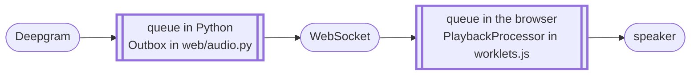

# Module 5: Interruption done right

**Goal:** Make the agent stop talking the moment you start.

**You'll learn**

- Why "the server stopped sending audio" and "the speaker stopped talking" are different events
- That more than one queue sits between the agent and your ears, and why clearing one is not enough
- What `UserStartedSpeaking` is actually telling you

## Start here

Before you write anything, run this file and **interrupt the agent mid-sentence**. Ask it something open-ended, wait for it to get going, then talk over it.

```bash
uv run steps/05-barge-in/main.py
```

It stops, but about a second late. For that second it talks right across you, while the console prints `>> UserStartedSpeaking`. The server knew you'd started talking, stopped sending, and told you immediately. Your speaker kept playing what had already arrived. Interrupt early in a long answer and keep talking, or that second is easy to miss.

That second is the entire module.

**Do not skip that.** Hear the agent talk over you at least once before you write the fix. The bug
is far more memorable than the patch, and it is the only time in the course you get to experience
the problem before you know the answer.

## How it works

`UserStartedSpeaking` arrives only after the server has already done its part. Flux detected start-of-turn inside the model. The agent stopped generating. The server stopped sending audio.

The problem is everything it *already* sent. The agent produced every byte of that before you opened your mouth, and all of it is still on its way to your ears. Deepgram streams speech about a second ahead of real time, so that is about a second of the agent talking over you, and more on a slow network. When that runs out, `PlaybackProcessor` fills the gap with silence and the agent goes quiet, which is why it stopped on its own even though nothing in your code told it to. Nothing upstream can help, because that audio has already left the building. Throwing it away is your job, and yours alone.

This is the client's one real obligation in a Flux voice agent. Everything else about turn-taking happens server-side.

Here is the part that catches people: **two queues sit between the agent and your ears**, and clearing only one leaves the bug in place.



Most of the time that backlog sits in the browser: the pump in [`web/bridge.py`](../../web/bridge.py) forwards each frame as soon as it arrives, and on your own machine nothing pushes back. Put the page on a slower network and the backlog waits in the Python queue instead, ready to refill a browser queue you just emptied. You don't get to choose where the audio is when the caller interrupts, so clear both.

`player.clear()` does both, in the order that matters: drop the Python side **first**, then send the browser its instruction. Read `BrowserPlayer.clear` and `Outbox.drop_audio` in [`web/audio.py`](../../web/audio.py). Note that `drop_audio` removes only the audio frames and leaves control messages alone, and note the comment explaining why the ordering holds across threads.

## Do this

**TODO 5.1: Add the `UserStartedSpeaking` branch.**

```python
elif message_type == "UserStartedSpeaking":
    player.clear()
    print(">> User started speaking (barge-in: playback cleared)")
```

**The trap, if you ever write this yourself.** On the `--local` path the same call has to reach for PortAudio, and there the choice is `abort()` versus `stop()`. `stop()` **drains** the buffer. It plays everything already queued and *then* stops, which is precisely the behavior you are trying to eliminate. It is the single most common bug in a first voice agent, and it survives code review easily because `stop()` reads like the more polite call. See `LocalPlayer.clear` in [`web/audio.py`](../../web/audio.py).

## Verify

Run it and talk over the agent again. It stops mid-word:

```
[assistant] Please bring a valid ID, your insurance card, and any relevant medical records or
            information about your medications.
>> User started speaking (barge-in: playback cleared)
[user] Sorry. Actually, I just need to change the date.
[assistant] No problem!
[assistant] Could you please provide me with your current appointment date and the new date you'd like?
```

That is a real interruption: the agent was mid-list about what to bring, the caller changed the
subject, and the agent dropped the rest of the sentence and followed. The cut is immediate and a
little abrupt, which is right. Human conversation works the same way.

Note what the agent did *not* do: carry on about insurance cards for another second and then
answer. That version is the one you heard before you wrote the branch.

Your browser cancels most of the echo from your speakers, which is why this module no longer requires headphones. It is not perfect on every browser, though, and this is the module where the difference shows. If the agent starts interrupting itself, that is echo rather than a bug in your code. Headphones eliminate this echo.

## Checkpoint

**Interrupt the agent mid-sentence. It has to stop immediately**: mid-word, not at the end of
the clause it was on.

Two ways to be sure it is really working:

1. **`>> User started speaking (barge-in: playback cleared)`** prints, rather than the bare
   `>> UserStartedSpeaking` fallthrough. If you see the bare version, your branch is misspelled or
   in the wrong place.
2. **It stops dead, not after a beat.** A short trail-off means you cleared one queue and not the
   other: which is the half-fixed version, and the most instructive bug in this course. It is
   worth deliberately building it once via `Going further`.

If the agent starts interrupting *itself*, that is your speaker feeding your microphone past the
echo canceller, not a fault in your code. Headphones fix it.

## Stuck?

**Still talks over you, but only briefly.** You cleared one queue and not the other. On your own machine that's almost always the browser's, the `this.queue.length = 0` in `PlaybackProcessor`. On a slow network it can be the Python-side `Outbox`.

**Nothing changes at all.** Check that the branch actually runs. `>> User started speaking` should print; if you only see the bare `>> UserStartedSpeaking` fallthrough, the branch is in the wrong place or misspelled.

**The agent interrupts itself constantly.** Speaker bleeding into microphone, past the echo canceller. Use headphones. If you're stuck on laptop speakers, turn the volume down and expect some of this.

**It cuts you off too eagerly, mid-thought.** That's turn detection rather than barge-in, and it's exactly what Module 9 tunes.

`steps/06-make-it-yours/main.py` is this module, finished.

## Recap

- **`UserStartedSpeaking` arrives after the server has already done its part.** Flux detected start-of-turn, the agent stopped generating, the server stopped sending. Everything already sent is still on its way to your ears.
- **Throwing that audio away is the client's one real obligation** in a Flux voice agent. Everything else about turn-taking is server-side.
- **Two queues sit between the agent and your ears**: one in Python, one in the browser. Locally the backlog sits in the browser; on a slow network it backs up in Python. Clear both, far one first.
- **On the PortAudio path, `stop()` drains and `abort()` discards.** `stop()` reads like the politer call and does exactly the thing you are trying to eliminate.
- The Voice Agent API reconciles what the caller *actually* heard into the conversation history, so the language model does not believe it finished a sentence that was cut off.

## Going further

Comment out the `this.queue.length = 0` line in `PlaybackProcessor`'s `clear` handler, leaving the Python-side drop in place. Interrupt the agent. You have just built the half-fixed version, the one that clears one queue and forgets the other. Time how long it keeps talking. On your own machine it sounds almost exactly like the unfixed version you heard at the start, because nearly all of the backlog sits in the browser: clearing only the Python side changes almost nothing. That interval is what every voice agent that feels "laggy" or "rude" is actually suffering from, and you can now recognize it by ear in someone else's product.

---

Your agent listens, thinks, speaks, and yields the floor. What it doesn't have is a personality. Right now it's a stock assistant with a stock voice.

**Next:** [Module 6: Prompting for the ear](../06-make-it-yours/LAB.md)
